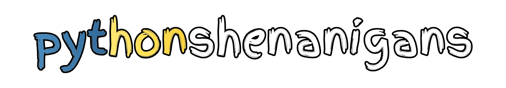

<div align="center">
  
  <br />
  <em>the ssssnakiest way to build jjs movesets</em>
</div>

     

[](https://pypi.org/project/pythonshenanigans_)

> [!IMPORTANT]
> This library is inspired by [FormunaGit/libjjs](https://github.com/FormunaGit/libjjs), and the code of this library has and is based on the code of libjjs. Please know that by using this library in your own code, when publishing it, don't only copyright *"itzdanti and PythonShenanigans contributors (pythonshenanigans, https://github.com/dnd-ed/pythonshenanigans)"*, but also copyright *"Formuna (libjjs, https://github.com/FormunaGit/libjjs)"*.

## How?

<details>
<summary>TL;DR, character codes are generated by compressing JSON through zstandard and base64-encoding it.</summary>

The way character codes are generated is by taking the original JSON and compressing it through [zstd](https://github.com/facebook/zstd) and then base64-encoding it. This is very easy to reverse, and can be used to create custom movesets externally without the need for Roblox or JJS.

Let's try it out. This is a basic character featuring one attack, an instant Todo swap, and a nameless awakening that creates Heian Sukuna's "Dismantle Net":

```
KLUv/WCJA40PALZaVSYQq+oBsOM43sl9eKAChX7vhegbSNzqodFpbd8lezRGBFEAAAAAOEcASQBOAJ03z8REfJoIHQUUIeRA2Vminb3zQON2lp3zdsnO2YVSO28t+/FL7VA2wXS0d63UcQ0c7V2ZYJr2LXs+3rZnDRbsQLYkfW9XPzAxMA2IsvME+MdLjvPn/NmJYnonKuH8cf4U0NsZ07eeiHgUS6LDS3aeF2LwoPYf1L5LIoQRchZQ0zTweU9EPH+X7GxNGpkVFQ/XVSYUB4G3eSbKttYk1WmK2jujgGG4ZOeFrOrsEsdpYlRAT7NQLKCEAxHQExowS8NVJpiFgaPZaMzOjmmAw/drfcilEefF2FRTnSKHa5LMBUPRMO2CTS6U4OuU2hvAUjsdb/1E8VcQqTfPtOzMgUGTneuM7EedHULqFMkX26fVR9ysjLfTchkFAYOJJnVpNKn73pzUbQUsPCAwQmKUdHZDsOFRRQGDZJeg4u6FMgn9G4xiAPIHGdrNOg4s5CTYCMJiCAp+76pl4PKqVSgDF8iWuV4akML0PQhEMn2ZxDIoECGsfoU0I8XsfY4F7awNkGkx71XcGk5v2o65yPltaZAXHDe2ACCX8IZgO6luOUUiiHldxh0CwYHoazqecXAVjSR5gj3dmmrpkHIMI2aSyjgZ
```

Decoding this from base64 and decompressing it with zstd gives us the original JSON. Shown below as Python repr for readability — it is **not** valid JSON (the real payload uses double quotes):

```python
[
    {
        'ADD': False,
        'NAME': 'Attack',
        'K_NAME': 'SKILL',
        'KEY': 1,
        'DATA': '{"Line":[{"K_NAME":"SFX","ID":138158731526545},{"PREVIEW":[0,0.5606122289385115],"K_NAME":"ANIM","ANIM_USE":[1,5]},{"TIME":0.56,"K_NAME":"WAIT"},{"SIZE":"6, 6,
4","PREVIEW":[0,15],"POSITION":"0, 0, 3","DAMAGE":5,"K_NAME":"HITBOX"},{"ALT COLOR":"255, 0, 0","COLOR":"255, 0, 0","TIME":3,"K_NAME":"VISUAL","LAST HIT":0.5,"EFFECT":"Black
Flash"},{"PREVIEW":[0.5606122289385115,1.1348979268755233],"K_NAME":"ANIM","ANIM_USE":[1,5]}],"Req":[],"Prop":[]}',
        'COOLDOWN': 5
    },
    {
        'COOLDOWN': 0,
        'NAME': 'Quick Swap',
        'DATA': '{"Line":[{"SPEED":100,"K_NAME":"SPECIAL","SPEC":"Boogie Woogie","ENABLE
VARIANTS":false},{"VOLUME":1,"K_NAME":"SFX","ID":138158731526545,"CANCEL":true}],"Req":[],"Prop":[]}',
        'K_NAME': 'SPECIAL'
    },
    {
        'DURATION': 0,
        'NAME': '',
        'K_NAME': 'AWAKENING',
        'DELAY': 0,
        'DATA':
'{"Line":[{"K_NAME":"SPECIAL","SPEC":"Incantation"},{"K_NAME":"SPECIAL","SPEC":"Incantation"},{"K_NAME":"SPECIAL","SPEC":"Incantation"},{"K_NAME":"SPECIAL","SPEC":"Incantation"}],"Req":[],"
Prop":[]}'
    }
]
```

From this, we can modify this JSON to create custom moveset through scripts.
</details>


## Usage

First, install the library using `pip install pythonshenanigans`.

Then, in a Python file, import the library and create a character.

```python
import pythonshenanigans as pts

character = pts.Character()
```

From here, you can create skills using `character.create.skill()`.

```python
character.create.skill(
    name="Super Cool Skill",
    cooldown=5,
)
```

Check out demo/demo.py for a full example.

## Features

- [x] Support for every documented node, condition and property
  - `PARTICLE`, `LOOK` and `SETMELEE` are modelled as pass-throughs; their field
    schemas are not documented in-game yet
- [x] Support for all skill types
- [x] Exports as a JJS-valid character code
  - I recommend you paste it into JJS to check if it's working, then copy the character block's export
- [x] Branch support
- [x] Variable names for animations, easing styles/directions, effects, etc
- [ ] Custom nodes
  - [ ] Domain node
- [ ] Fake rigs
  - [ ] Fake rig animations
